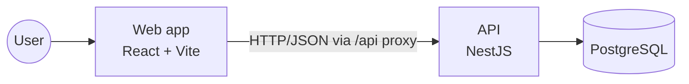
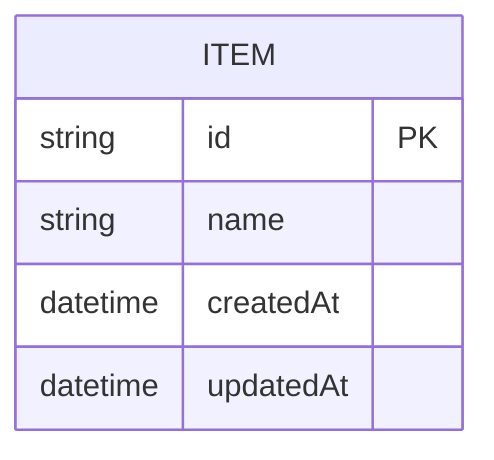
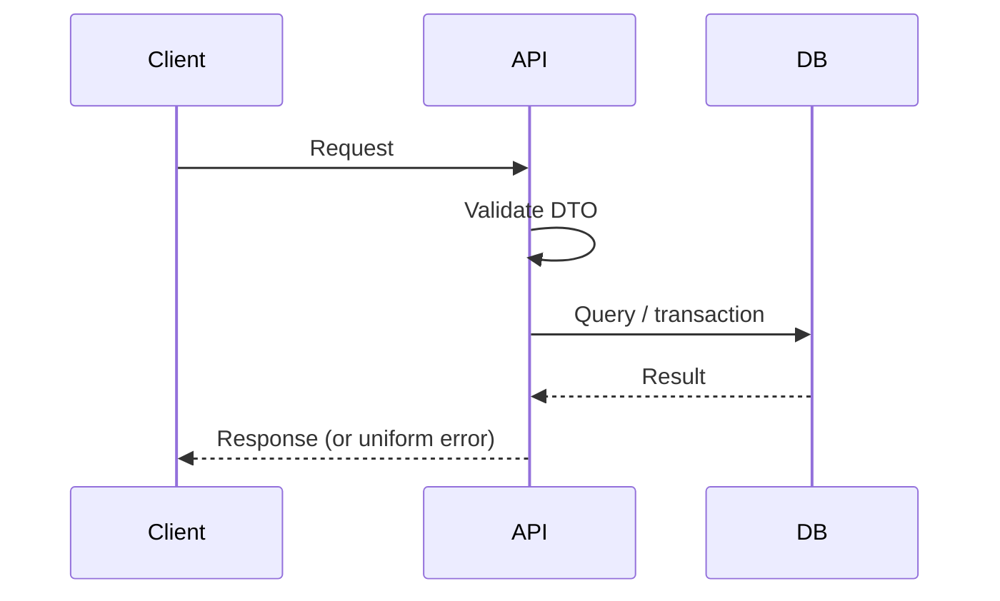

# System design

## 1. Overview
<!-- 3–5 lines: what the system does, for whom, and the main constraint. -->

## 2. Context

## 3. Components

| Component | Responsibility | Key files |
|---|---|---|
| Controllers | HTTP routing, DTO validation | `backend/src/*/*.controller.ts` |
| Services | Business rules, transactions | `backend/src/*/*.service.ts` |
| Prisma | Data access, migrations | `backend/prisma/`, `backend/src/prisma/` |
| Exception filter | Uniform error responses | `backend/src/common/` |
| Web client | Typed API calls, async states | `frontend/src/api.ts`, `frontend/src/useApi.ts` |

## 4. Data model

## 5. Key flows
<!-- Sequence diagram of the most important or riskiest flow. -->

## 6. Cross-cutting concerns
- **Validation**: global `ValidationPipe` (whitelist, forbidNonWhitelisted, transform).
- **Errors**: one response shape `{ statusCode, error, message, path, timestamp }`.
- **Concurrency**: _how races are prevented (transactions, locks, atomic updates)._
- **Idempotency**: _which operations are idempotent and how._
- **Configuration**: environment variables, documented in `backend/.env.example`.
- **Observability**: `GET /health` reports API and database status.

## 7. Scalability and failure modes

| Scenario | What happens | Mitigation |
|---|---|---|
| 10x traffic | | |
| Database down | `/health` reports `degraded`; requests return 500 with the uniform shape | |
| Concurrent writes on the same record | | |

## 8. What I would do with more time
-
