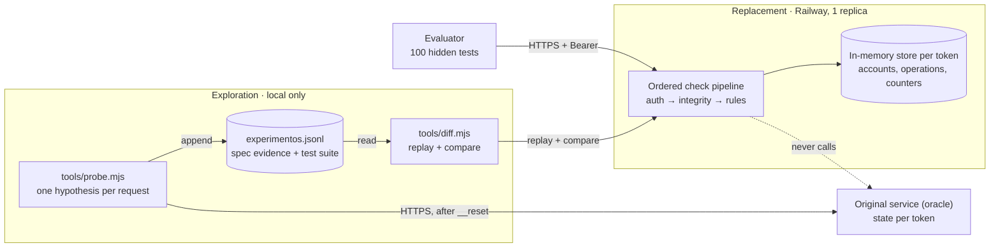

# System design: black box replacement

Markdown version of the published design document. The full bilingual version, with the interactive checksum calculator and the searchable experiment log, is [site/docs/index.html](../../site/docs/index.html), served at `/docs` of the documentation site.

Frontier hackathon (Lab10), 10 October 2026. Jerónimo Rodríguez. Stack: Node.js, TypeScript, `node:http`, Railway.

## 01 · Summary and objective

- **What we build.** An HTTP service that accepts exactly the same requests as the original and returns the same status and the same body, errors included. It ships with a specification that lets another engineer reimplement it without touching the original, and the experiment log that proves each claim.
- **For whom.** The company that depends on the service (its clients must not notice the swap) and the engineers who will maintain it.
- **What it turned out to be.** A small core-banking protocol over `POST /msg`: open accounts, check balances, deposit, transfer and reverse operations, with a mod-97 checksum per message, per-client state, a transfer limit and an account lock.
- **Expected result.** At least 95 of the 100 hidden tests passing at 20:00, every documented behavior backed by a cited experiment, and zero false claims in the specification.

## 02 · Requirements and constraints

Requirements FR1–FR7 and NFR1–NFR6, with evidence and status: [requirements.md](../requirements.md).

| Constraint | Detail |
|---|---|
| Time | One day, one engineer. Design by 12:00, delivery by 20:00. |
| Probe budget | 10 requests/s and 8,000/day per token; tokens stop working against the original at 20:00. |
| Runtime | The evaluator talks to one process; several instances would each hold their own state. |
| No shortcuts | No tools that do the work; own scripts and fuzzers allowed. |
| Moving target | The original can change; we are judged on the 20:00 version. |
| Hidden tests | 40 single requests, 45 sequences of 2–5, 15 of 6–12; none repeats the public examples. |

## 03 · Scope and assumptions

**In scope:** the HTTP contract (routes, auth, bodies, every error and its order); the six commands and their state; detection and replication of behavior changes during the day; specification, experiment log and documentation.

**Out of scope:** durability across restarts (every test starts with a reset); horizontal scaling and multi-instance consistency; response headers (not compared; `X-Req` is replicated anyway); "fixing" inherited flaws (compatibility wins; they are listed as risks).

Confidence levels: **confirmed** = probed and repeated; **probable** = seen once or inferred; **assumed** = not probed, it is the replacement's default.

| Statement | Confidence | Evidence |
|---|---|---|
| Checksum = 98 − (N mod 97) over the uppercased message, A=1…Z=26, other characters dropped, "00" appended | confirmed | examples 1–20, 43–60 |
| Transfer limit is 50,000 per transfer (inclusive) since v2 (FR-0153); it was 100,000 in v1 | confirmed | v2: 818, 559, 560, 690; v1: 74–75, 99–101, 125–126 |
| 3 consecutive rejected transfers (E506 limit or E507 insufficient funds) lock the source; a success resets the count | confirmed | 99–105, 125–134, 149–153 (v1); 558–561, 827–830 (v2) |
| Locked source answers 423 E510 with `"intentos":N` (N = consecutive attempts from 1) since v2; 409 without `intentos` in v1 | confirmed | 561–562, 586–589, 612–618, 742–748, 811, 830–831 (v2) |
| `POST /__reset` resets `intentos` | confirmed | 719, 742 |
| `intentos` restarts at 1 after a deposit unlocks the account | assumed | no re-lock after an unlock was probed (MEM-26) |
| `CONSULTA` `saldo` is a string with 2 decimals (stored integer / 100) since v2; a number in v1 | confirmed | v2: 563, 625, 684, 826, 834; v1: 51, 554 |
| The limit changed between 10:36 and 10:44 | probable | 64 vs 125 |
| A successful deposit resets the rejection count and lifts an existing lock | confirmed | 175–179, 278–281 |
| A lock does not expire with time or with other commands: only a deposit or a reset lifts it | assumed | — |
| Query strings are ignored when matching routes | confirmed | 160–161 |

## 04 · Risks and hard cases

| Hard case | What the original does | How the design handles it |
|---|---|---|
| Two faults in one message | Only the first check in its order fails | One ordered pipeline; each pair of checks pinned by an experiment |
| Duplicates and retries | `ANULA` is idempotent (second call: `ok:false`); `ALTA` with a repeated name creates a new account; a repeated `DEPOSITO` applies twice | Replicated as-is; listed as an inherited risk (no idempotency key) |
| Concurrency | The evaluator sends one step at a time per test | Node's single event loop runs each request to completion: no interleaving, no locks needed |
| Invalid data | Bad JSON, missing `m`, empty segments, malformed amounts, ids in lowercase | Each mapped to its exact error; no trimming, no normalization beyond what the original does |
| Negative balances | A reversal can leave an account below zero | Replicated; reported in the specification's Risks section |
| The original changes | Already happened once (transfer limit) | Replay of the log against the original through the logged probe; business limits in configuration |
| Process restart | — | State is lost, which is acceptable because every test begins with a reset; Railway restarts the process on crash |
| Several instances | — | Pinned to one replica |
| Unseen input in the hidden set | Unknown | Targeted fuzzing of each boundary; any remaining unknown gets a stated default |

## 05 · Proposed architecture

Two halves with a hard boundary: exploration tooling, the only thing allowed to reach the original, and the replacement, which never calls it.

Trust boundary: authentication happens at the replacement's edge. The dotted arrow marks the dependency that must never exist.

### Architectural style: a layered monolith with a validation pipeline

One process, four layers. Dependencies point only downward, so the protocol can be tested without HTTP and the state knows nothing about the rules. Inside the application layer, validation is a pipes-and-filters chain where the first failing check answers.

| Layer | Files | Responsibility | Does not know |
|---|---|---|---|
| Transport | `server.ts` | Routing, Bearer auth, `X-Req`, JSON reply, structured log | Accounts or business rules |
| Application | `protocol.ts` (pipeline) | Order of checks, dispatch to the command | HTTP, headers |
| Domain | `protocol.ts` (commands), `control.ts` | Amounts, limit, lock, reversals, checksum (pure function) | How the message arrived |
| State | `store.ts` | Accounts, operations, id sequences per token, in memory | Any rule |
| Cross-cutting | `errors.ts`, `config.ts` | Error catalog verbatim; limits from environment | — |

Dependency rule: `server → protocol → store / control / errors / config`.

### Exploration tooling (not deployed)

| Tool | What it does |
|---|---|
| `tools/probe.mjs` | Sends an experiment to the original after a reset and appends each request to `experimentos.jsonl` |
| `tools/diff.mjs` | Replays logged sequences against a target with the official comparison rules |
| `tools/control.mjs` | Computes the checksum for hand-written experiments |
| `tools/conclude.mjs`, `view.mjs`, `build-site.mjs` | Write conclusions, render the readable log, publish the log to the site |

### Main flow: one request, end to end

| Step | Check | Fails with |
|---|---|---|
| 01 | Route and method (`POST /msg`, `GET /health`, `POST /__reset`) | 404 E404 |
| 02 | Bearer token (the trust boundary) | 401 E001 |
| 03 | Count the request (`X-Req`), parse JSON, require a string `m` | 400 E100, 400 E102 |
| 04 | Has a `;`, no empty segment | 400 E103, 400 E104 |
| 05 | `PING` short-circuits: arity only, no checksum | 200 pong, 400 E302 |
| 06 | Checksum format, then value (exact text) | 400 E201, 400 E202 |
| 07 | Known command (E301 may add `sugerencia` for a near command), then arity | 400 E301, 400 E302 |
| 08 | Amount 1…9,999,999,999 (no sign, no leading zero), then source ≠ destination | 400 E303, 400 E304 |
| 09 | Account or operation exists (case-sensitive ids) | 404 E401, 404 E402 |
| 10 | Locked source → limit → balance (each rejection updates the lock counter) | 423 E510 with `intentos` (v2; 409 in v1), 422 E506, 422 E507 |
| 11 | Apply the effect, assign the next id, answer | 200, 201 |

Exact bodies and the evidence for each step: [api.md](../api.md).

### Hidden commands and the E301 suggestion

Found by probing unknown command names (experiments 180–271). Details and exact bodies: [api.md](../api.md).

| Behavior | What the original does | Evidence |
|---|---|---|
| `NOTAS` (no arguments) | 200 with one fixed note, the same in every state | 255, 261, 263 |
| `HALT` (one argument) | 409 E520: a guard that asks for confirmation. No way to confirm was found; the destructive path is **assumed** unreachable and the replacement never stops | 259, 264–271 |
| E301 `sugerencia` | An unknown command at edit distance 1 or 2 from a known one gets `"sugerencia":"<command>"`; at 3 or more it does not | 180–253 |

Security: the text of the `NOTAS` note is planted bait that asks for a token to be sent to an internal route. It is reproduced verbatim as data and never acted on.

### Contracts

| Interface | In → out | Errors | Guarantees |
|---|---|---|---|
| `POST /msg` | `{"m":"CMD;args;CTRL"}` → command result | E100–E510 | First failing check wins; failed requests change no state except the lock counter on E506 and E507 (and `intentos` on a locked source, v2) |
| `POST /__reset` | — → `{"ok":true}` | E001, E404 | Clears accounts, operations and id sequences for the token; `X-Req` keeps counting |
| `GET /health` | — → `{"ok":true}` | E001, E404 | Requires the token, like the original |
| pipeline → store | validated command → mutation + new id | — | Effects run only after every check passed; ids are never consumed by failures |

### Domain model and invariants

- **Account** `AC-0001…`: name, balance, consecutive rejected transfers, locked, and (v2) `intentos`: consecutive attempts against the locked account.
- **Operation** `OP-0001…`: deposit or transfer, amount, accounts, reversed.

Invariants:

- Ids are sequential per token and restart after a reset.
- An operation is reversed at most once.
- A locked account can still receive funds and deposits; a successful deposit lifts the lock (278–281).
- A transfer never moves more than the limit or the balance.

### The checksum

`control = 98 − (N mod 97)`

Found by noticing that changing one digit moved the control by −3 modulo 97, the signature of a mod-97 check like IBAN, then searching letter mappings until all valid examples matched. N is the message without its control, uppercased; A=1…Z=26, digits kept, other characters dropped, `00` appended. Compared as exact text.

### Security, observability and recovery

- **Security.** Team token in an environment variable (`TEAM_TOKEN`), never in the repo; probe token in a gitignored file (`.env.tools`); constant 401 body for missing and wrong tokens; no outbound calls from the replacement.
- **Observability.** One structured log line per request: route, command, status, error code, latency. Tokens and message bodies are never logged. Health check for liveness. The diff harness is the correctness monitor.
- **Recovery.** Crash → Railway restarts the process; state loss is harmless because tests reset first. Bad deploy → roll back to the previous Railway deployment.

## 06 · Decisions and trade-offs

| Decision | Discarded alternative | Justification (requirement it serves) | Accepted cost | Record |
|---|---|---|---|---|
| Layered monolith, single process | Microservices; modular monolith (NestJS modules) | One small domain, shared in-memory state and one process required by the evaluator | No independent scaling or deployment of parts | [ADR-0001](../adr/0001-layered-monolith-node-http.md) |
| Plain `node:http` + TypeScript | NestJS / Express | FR2, NFR1: frameworks answer unknown routes and bad JSON with their own bodies; we must control every byte | Routing and body parsing by hand | [ADR-0001](../adr/0001-layered-monolith-node-http.md) |
| In-memory state, one store per token | PostgreSQL | NFR2, FR1: one process, reset before every test, 5 s per step | State lost on restart; single instance only | [ADR-0002](../adr/0002-in-memory-state-per-token.md) |
| Single event loop instead of locks | Mutexes / transactions | FR6: each handler is synchronous, so a request runs to completion without interleaving | Must keep handlers free of `await` | [ADR-0002](../adr/0002-in-memory-state-per-token.md) |
| Deterministic rules, no LLM in the path | LLM fallback for unseen inputs | NFR1, NFR2, NFR4: exact-match scoring punishes variance; an LLM adds seconds and cost | Unseen inputs get a documented default | [ADR-0006](../adr/0006-deterministic-rules-no-llm.md) |
| Checks as an ordered pipeline | Nested if/else per command | FR4: the error order is part of the contract and must be easy to reorder | More structure up front | [ADR-0003](../adr/0003-ordered-validation-pipeline.md) |
| Business limits in configuration | Constants in code | NFR6: a limit change becomes an environment edit and a restart | One more place to check during review | [ADR-0005](../adr/0005-business-limits-in-configuration.md) |
| The experiment log is the test suite | Hand-written tests only | FR7, NFR1: every rule is proven against the oracle and replayed automatically | Covers only what was probed | [ADR-0004](../adr/0004-experiment-log-as-regression-suite.md) |
| Railway with one replica; docs as a static site on Vercel | Several replicas; docs served by the replacement The evaluator talks to one process and each instance would hold its own state; the docs are static files and need no runtime | No redundancy; two deployments to keep in sync | [ADR-0007](../adr/0007-railway-single-replica-vercel-docs.md) |
| Mid-event v2 (FR-0153): the limit through `TRANSFER_LIMIT`; `intentos` and the saldo string in code | Limit in code (a value change needs a build and a deploy) | NFR6, ADR-0005: a limit change is a configuration edit; the rule changes need code and are backed by s14 | v1 recordings superseded; `intentos` restart after an unlock assumed | [ADR-0008](../adr/0008-adapt-to-v2-incident.md) |

## 07 · Validation and measurement

| Metric | Method and conditions | Baseline | Target | If missed |
|---|---|---|---|---|
| Replay match rate (NFR1) | `diff.mjs` replays every logged sequence after a reset, official comparison rules | 144/145 at 11:00 (the miss is the pre-change version) | 100% of current-version steps | Each mismatch becomes a new experiment before any code change |
| Hidden set pass rate | Validate the entrypoint in `/evento`; read `/evento/resultados` | First run after deploy | ≥ 95 / 100 | Fuzz the area of the failing category; re-validate after each fix |
| Error coverage (FR4) | Each error code and each adjacent pair in the pipeline has at least one logged experiment | 18 / 18 codes | 18/18 codes, 10/10 order pairs | Probe the missing pair |
| Specification accuracy (FR7) | Every behavior row cites log ids; a confirmed row needs ≥ 2 consistent ids | — | 100% cited, 0 uncited claims | Downgrade to probable or remove |
| Latency (NFR2) | 60 s burst at 10 req/s against the deployed URL, measured client-side | Local: < 5 ms | p95 < 50 ms, p99 < 500 ms | Move region closer, check cold starts |
| Drift detection (NFR6) | Replay the log against the original every 1–2 h until 19:30 | 1 change found (10:44) | 0 unexplained diffs at 19:30; fix in < 15 min | Incident playbook (section 08) |
| Probe budget | Lines in `experimentos.jsonl` | 145 at 11:00 | < 2,000 of 8,000 | Narrower, hypothesis-driven sequences |

Test strategy and acceptance criteria: [testing.md](../testing.md).

## 08 · Implementation plan and open questions

| Time | Milestone |
|---|---|
| 10:30 – 11:00 | Exploration tooling, 145 experiments, protocol decoded, first replacement (144/145) |
| 12:00 | Design document delivered |
| 13:30 | Open questions probed; unit and order tests in place; local replay at 100% |
| 15:00 | Deployed on Railway (1 replica); first validation in `/evento` |
| 15:30 | Incident drill: stop feature work → reproduce with the probe → log evidence → change one rule or config → replay everything → redeploy → write the timeline |
| 18:30 | Specification complete; drift check against the original |
| 19:30 | Final drift check, 2-minute video, submission |

Only the first milestone is recorded as done in the published design. The rest is the plan.

### Changes detected during the day

| When | What changed | How it was detected |
|---|---|---|
| 10:36 → 10:44 | A 100,001 transfer went from accepted to rejected (E506): the limit became a fixed 100,000 (v1) | #64 contradicted #74; re-probed under identical conditions in #125 |
| 15:30 (FR-0153, incident) | v2: locked account 409 → 423 with `intentos`; `saldo` becomes a 2-decimal string; limit 100,000 → 50,000. Last v1 run 15:29 local; first changed run s04-drift3 at 16:05 local (`tools/drift.mjs`); isolated with s14 (815–834) | 561–563, 559–560, 818 |

### Open questions to validate

- Does a lock expire with time or with any other command?
- Body size limit, duplicate JSON keys, non-UTF-8 bytes.
- `HEAD` and `OPTIONS` on known routes.
- What happens after `AC-9999` or `OP-9999`?
- Will the limit or other rules change again before 20:00?

### Inherited risks a new client should not copy

| Risk | Fix |
|---|---|
| Reversals ignore balances and can leave an account negative (#141) | Reject a reversal that would overdraw, or record a debt |
| No idempotency key: a retried `DEPOSITO` or `TRANSFER` applies twice | A client-supplied request id |
| The mod-97 checksum detects typos, not tampering: anyone can compute it | An HMAC with a shared secret |
| `PING` skips integrity; inconsistent field names (`cuentaId` / `cuenta_id`) and a typo (`recieved`) are part of the contract | A versioned v2 API |
